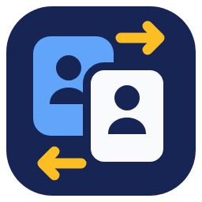
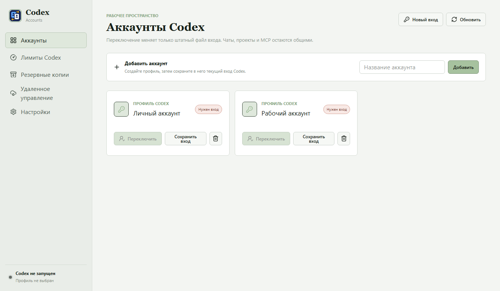

# Codex Accounts

<p align="center"></p>

Компактный переключатель аккаунтов OpenAI Codex для Windows 10/11. Живёт в трее рядом с часами: нажмите на значок, выберите сохранённый аккаунт — приложение переключит вход и перезапустит Codex.

Добавлена экспериментальная поддержка **Ubuntu 24.04 Desktop x86-64**: отдельный
Linux-backend, GNOME Secret Service и сборка `.deb`/AppImage. Настройка,
ограничения и получение тестовых пакетов: [Ubuntu](docs/UBUNTU.md).



## Возможности

- Список аккаунтов по нажатию на значок в трее, текущий аккаунт отмечен галочкой.
- В Windows список открывается в попапе с крупным шрифтом и остатками лимитов за 5 часов и неделю; правой кнопкой доступно системное меню.
- Переключение одним нажатием; повторные нажатия блокируются до завершения операции.
- Большое окно открывается через **Управление аккаунтами…** или ярлык с параметром `--manage`. Его закрытие оставляет приложение в трее.
- Поддержка Codex из Microsoft Store и распакованной настольной версии.
- Единая иконка с двумя карточками аккаунтов и стрелками: трей, интерфейс, исполняемые файлы и установщики.
- Сохранение чатов, проектов, MCP, плагинов, skills и настроек в общем Codex Home.
- Шифрование сохранённых данных входа через Windows DPAPI, резервное копирование и восстановление предыдущего входа при ошибке переключения.
- Просмотр пятичасовых и недельных лимитов, резервные копии и дополнительные настройки в основном окне.
- [Перенос аккаунтов через Google Drive](docs/GOOGLE-DRIVE.md): прямое сохранение и загрузка по мастер-паролю между Windows и Ubuntu. Для прямого подключения сборке нужен OAuth-клиент Google; перенос через файл доступен отдельно.

## Как пользоваться

1. Запустите **Codex Accounts**. Если значок не виден, откройте область **˄** рядом с часами.
2. Нажмите значок и выберите **Управление аккаунтами…**.
3. Проверьте папку Codex Home, обычно `%USERPROFILE%\.codex`.
4. Добавьте аккаунт, выполните вход в Codex и сохраните его в профиль через приложение.
5. Для следующего входа нажмите значок в трее и выберите другой готовый аккаунт.
6. Пункт **Выход** завершает переключатель.

Переключение закрывает и снова запускает Codex. Не нажимайте обычную кнопку выхода из Codex между сохранёнными профилями: она может отозвать токен входа. Аккаунты без готовых сохранённых данных видны в меню, но недоступны для переключения.

## Распакованная версия Codex

Создайте файл `%APPDATA%\CodexAccountSwitcher\codex-executable.txt` с единственной строкой — абсолютным путём к настольному исполняемому файлу. Например:

```text
C:\Apps\Codex\app\ChatGPT.exe
```

В распакованной Store-сборке основной файл может называться `ChatGPT.exe`; в других настольных сборках — `Codex.exe`. **Не указывайте `resources\codex.exe`: это CLI.** В выбранной папке должны быть `resources\app.asar` и `resources\codex.exe`.

Если задана переменная `CODEX_SWITCHER_DATA_DIR`, положите `codex-executable.txt` в указанную ею папку. После переноса Codex обновите путь. Удаление файла возвращает запуск Store-версии по AUMID.

## Сборка из исходников

Нужны Windows 10/11, .NET 8 SDK, Node.js 22.12+ и pnpm 11. Исходники и документация доступны в [публичном репозитории](https://github.com/sergeykrasilnikov1/codex-accounts). Наличие готовых пакетов проверяйте в [Releases](https://github.com/sergeykrasilnikov1/codex-accounts/releases).

```powershell
git clone https://github.com/sergeykrasilnikov1/codex-accounts.git
cd codex-accounts

dotnet test .\codex-account-switcher\CodexAccountSwitcher.Tests\CodexAccountSwitcher.Tests.csproj -c Release
dotnet publish .\codex-account-switcher\codex-account-switcher.csproj -c Release -r win-x64 --self-contained true -p:PublishSingleFile=true -o .\artifacts\backend\x64

cd desktop
pnpm install --frozen-lockfile
pnpm typecheck
pnpm test
pnpm build
$env:CODEX_SWITCHER_BACKEND = (Resolve-Path ..\artifacts\backend\x64\CodexAccountSwitcher.exe).Path
pnpm dev
```

Для локального x64-установщика после публикации backend:

```powershell
# Из папки desktop
pnpm exec electron-builder --win nsis --x64 --publish never
```

Полная матрица x64/x86, NSIS/MSI/portable и SHA-256 собирается через `scripts/build-release.ps1`. Скрипт требует действительные цифровые подписи; `-AllowUnsigned` допускает неподписанную локальную сборку, не делая её подписанной. Для публикации подписанных пакетов нужен собственный сертификат. Обновления направлены на этот репозиторий и выполняются только по отдельным действиям пользователя: проверка, скачивание, установка.

## Данные и безопасность

- Репозиторий содержит исходники и публичные изображения. Личные аккаунты, `auth.json`, токены, базы SQLite и резервные копии в Git не добавляются.
- Сохранённые входы и их резервные копии защищены DPAPI текущего пользователя Windows. Не переносите их на другой компьютер как способ переноса входа.
- Сохраняются прежние технические имена папок `CodexAccountSwitcher` и `codex-account-switcher-desktop`, идентификаторы установки и имя backend `CodexAccountSwitcher.exe`: это обеспечивает совместимость с существующими данными.
- Приложение переключает `auth.json`, а не копирует чаты и проекты между аккаунтами. Оно не обходит подписки или ограничения сервиса.
- Дополнительный Remote API и Telegram-интеграция унаследованы от исходного проекта. Не открывайте Remote API напрямую в интернет. См. [SECURITY.md](SECURITY.md) и [документацию API](docs/REMOTE_API.md).

## Проверки

- Backend: `dotnet test ...` — проверка переключения, резервных копий, DPAPI, обнаружения процессов и поддержки распакованного Codex.
- Интерфейс: `pnpm typecheck` и `pnpm test` — типы, контракты, единый брендинг, меню трея, блокировка повторных переключений и обработка ошибок.
- Проверка установленного приложения без смены аккаунта: `node tests/e2e/tray-smoke.mjs "C:\Path\Codex Accounts.exe"` из папки `desktop`. Перед запуском закройте работающий переключатель. Проверка читает список профилей, открывает и закрывает окно управления, но не переключает аккаунты.
- `scripts/security/audit-release.ps1` проверяет имена файлов и секреты через Gitleaks. Материалы в `docs/testing` описывают исторические проверки исходного проекта и не заменяют проверку этой версии.

## Происхождение и лицензия

Codex Accounts основан на [korsun009/codex-account-switcher](https://github.com/korsun009/codex-account-switcher) под лицензией MIT. Сохранены история разработки и авторское уведомление исходного проекта. В этой версии добавлены режим трея, поддержка распакованного Codex, новая иконка, название и отдельный источник обновлений.

[MIT License](LICENSE). Это независимый проект, не официальный продукт OpenAI.
